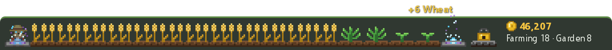
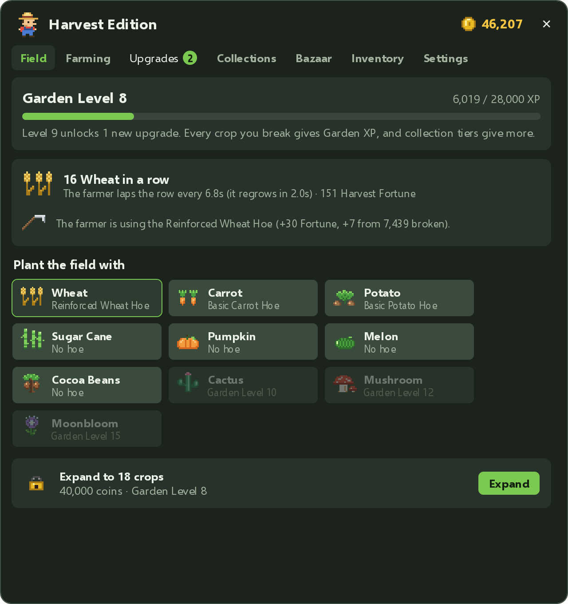
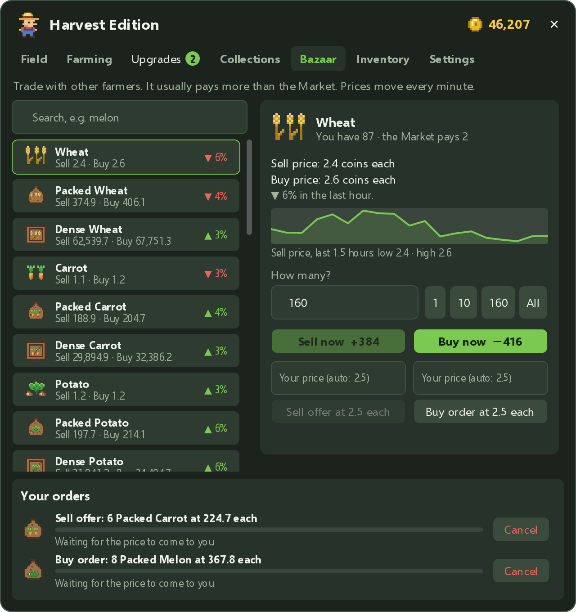
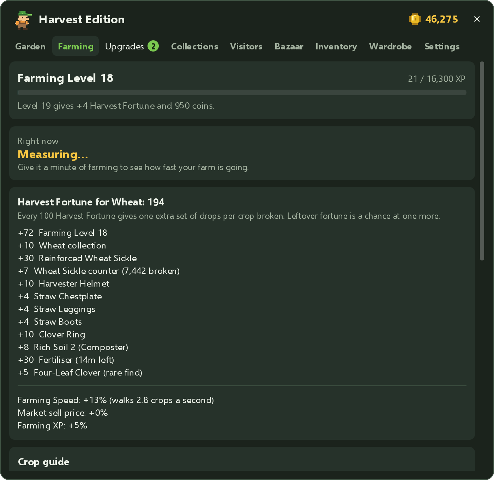

# TaskBarGame: Harvest Edition

> **This is the `harvest-edition` branch**, a version of TaskBarGame that plays more like Skyblock-style
> farming. It isn't merged into `main`; the original game lives there. The two editions keep separate
> saves, so you can play both.

A farming game that lives just above your Windows taskbar while you work. Your field is **one long row
of crops**. Your farmer walks it with their hoe, breaking every grown crop as they pass, then steps on a
**teleport pad** at the end that sends them back to the start. Crops regrow in a couple of seconds, so
the row is always grown again by the next lap. You level up, unlock crops, craft better **hoes**,
**armour** and **talismans** from your crops, trade on the **Bazaar**, and make the row longer.




Click the farmer (or your coins) to open the panel:

<p>
  
  
  
</p>

## Running it

Build the `.exe` yourself, or download the one GitHub builds for this branch: open
[Actions → Build](https://github.com/TheUthaGuy/TaskBarGame/actions/workflows/build.yml?query=branch%3Aharvest-edition),
click the newest run, and download **TaskBarGame-win-x64** under **Artifacts** (you need to be signed
in to GitHub). The [Download](#download) links at the bottom give the original edition, not this one.

To run it from the source code, you need **Windows 10 or 11** and the free
[.NET 10 SDK](https://dotnet.microsoft.com/download/dotnet/10.0).

```bash
dotnet run --project src/TaskBarGame.App
```

Or open `TaskBarGame.sln` in Visual Studio 2022/2026 and press **F5**.

To make a standalone `TaskBarGame.exe` you can share:

```bash
dotnet publish src/TaskBarGame.App -c Release -r win-x64 --self-contained true -p:PublishSingleFile=true -o publish
```

## How to play

| Do this | What happens |
|---|---|
| Click a **grown** crop | Break it yourself: +25 Harvest Fortune, and you see the XP you earned |
| Click a **growing** crop | Tend it: it regrows faster |
| **Hold the button and drag** along the row | Break (or tend) every crop you pass over |
| Right-click the row | Choose which crop to plant (the whole row changes) |
| Click the **farmer's head** or the **coins** | Open the panel |
| Right-click the farmer or the strip | Quick menu: plant, sell crops, strip size, position, show-on-hover, quit |
| Click the **lock** at the end of the row | Make the row longer (when you have the coins and Garden level) |

The farmer farms the row the way you would by hand: walking it from left to right breaking every grown
crop, then stepping on the teleport pad at the end, which sends them back to the pad at the start for the
next lap. They keep working while the game is closed, at half speed, for up to 12 hours. When you come
back, a popup tells you what they did.

### Stats

- **Harvest Fortune:** every 100 Fortune is one extra set of drops per crop broken (150 = 2.5x drops).
  It comes from your Farming level, that crop's collection, its hoe (and the hoe's counter), armour and
  the Clover talisman.
- **Farming Speed:** how fast the farmer walks the row, so how many crops they break a minute
  (Swiftstep talisman, Straw and Harvester set bonuses).
- **Farming XP:** bonus Farming XP from every crop (Scholar's talisman, Verdant set bonus).
- **Market sell price:** more coins when selling to the Market (Merchant's talisman). It doesn't apply
  to the Bazaar, or you could buy there and sell to the Market for free coins.

### Progression

- **Farming skill (levels 0-50):** XP from every crop broken. Each level gives **+4 Harvest Fortune** and coins.
- **Garden level (1-15):** Garden XP from every crop broken and every collection tier. Garden levels
  unlock crops, upgrades and field expansions.
- **Field:** starts at 10 crops and expands up to 24.
- **Collections:** 10 tiers per crop, each giving +2 Fortune for that crop and Garden XP. The
  Collections tab shows each crop's max (how many Tier X needs, from 2,000,000 Wheat to 10,000,000
  Melon) and how far you are towards it. Hover over a crop to see every tier.
- **Packing:** 160 crops pack into 1 **Packed** crop, and 160 Packed into 1 **Dense** crop. Packed crops
  sell for the same as the crops inside, but you need them for crafting.

Each crop is worth more per crop broken than the one before. The price of one item isn't the whole
story: a wheat drops 1 item, a carrot 3, a potato 4, so carrots and potatoes sell for less each but are
worth more per crop broken.

| Crop | Garden level | Regrows in | Drops | Sells for (each) | Worth per crop broken |
|---|---|---|---|---|---|
| Wheat | 1 | 2s | 1 | 2 | 2 |
| Carrot | 2 | 2.5s | 3 | 1 | 3 |
| Potato | 3 | 2.5s | 4 | 1 | 4 |
| Sugar Cane | 4 | 3s | 2 | 3 | 6 |
| Pumpkin | 5 | 3s | 1 | 9 | 9 |
| Melon | 6 | 3.5s | 5 | 2 | 10 |
| Cocoa Beans | 8 | 3.5s | 3 | 5 | 15 |
| Cactus | 10 | 4s | 2 | 9 | 18 |
| Mushroom | 12 | 4.5s | 1 | 24 | 24 |
| Moonbloom | 15 | 5s | 1 | 40 | 40 |

### Upgrades (crafted in the Upgrades tab)

**Hoes:** every crop has its own hoe, and the farmer automatically holds the one for the crop that's
planted. Its colour in the farmer's hands shows its tier.

| Tier | Fortune for its crop | Made from |
|---|---|---|
| Basic | +10 | 48 of the crop + 100 coins |
| Reinforced | +30 | 8 Packed of the crop + 5,000 coins (Garden 4) |
| Masterwork | +60 | 1 Dense of the crop + 100,000 coins (Garden 10) |

Every 1,000 crops a hoe breaks adds +1 Fortune for that crop (up to +30).

**Armour:** four pieces, each upgraded Straw → Harvester → Verdant. Wearing a full set gives a bonus.

| Set | Fortune per piece | Full set bonus | Made from |
|---|---|---|---|
| Straw | +4 | +5% Farming Speed | Packed Wheat (Garden 2) |
| Harvester | +10 | +15 Fortune, +5% Farming Speed | Packed Pumpkin, Melon, Sugar Cane, Potato (Garden 6) |
| Verdant | +20 | +25 Fortune, +10% Farming XP | Dense Cocoa, Cactus, Mushroom, Moonbloom (Garden 12-15) |

**Talismans:** four kinds, each upgraded Charm → Ring → Relic (+5 / +10 / +20). Owning one is enough.

| Talisman | Gives | Made from |
|---|---|---|
| Clover | Harvest Fortune | Carrot |
| Swiftstep | Farming Speed % | Sugar Cane |
| Merchant's | Market sell price % | Potato, then Melon |
| Scholar's | Farming XP % | Wheat, then Pumpkin, then Cocoa |

**Compactor:** packs crops for you as they're harvested, so you don't have to press Pack.

| Tier | What it does | Made from |
|---|---|---|
| Compactor | Every 160 crops become 1 Packed crop | 8 Packed Wheat + 8 Packed Carrot + 5,000 coins (Garden 3) |
| Dense Compactor | Also presses every 160 Packed into 1 Dense crop | 1 Dense Wheat + 16 Packed Melon + 100,000 coins (Garden 9) |

You can turn it off for any crop in the Inventory tab. It leaves alone any plain crops your next upgrades
use as they are (like the 48 crops for a first hoe).

The number on the **Upgrades** tab is how many upgrades you can craft right now, and a popup tells you
when a new one becomes ready. If an upgrade is only missing ingredients, **Buy missing** buys them on
the Bazaar in one click and shows what that costs.

### Bazaar

Buy and sell crops, packed crops and dense crops with other (pretend) farmers in the **Bazaar** tab.

- Every item has a **sell price** (what you get now) and a slightly higher **buy price** (what it costs
  now). Prices drift a little every minute and slowly return to normal. Selling a lot at once pushes the
  price down; buying a lot pushes it up. The arrows show how much it moved in the last hour.
- **Sell now / Buy now** trade straight away.
- **Sell offer** asks for a bit more than the sell price: your items are set aside and the coins arrive
  bit by bit while buyers are paying that much. **Buy order** bids a bit under the buy price: your coins
  are set aside and the items arrive while sellers are that cheap. Orders keep filling while the game is
  closed, and you can cancel them to get back whatever hasn't filled.
- Type **your own price** for a sell offer or buy order, or leave the box empty for the automatic one
  (just better than the current price, so it fills soon). You're warned if your price is worse than
  trading straight away.
- The **chart** shows the item's sell price over the last 2 hours, so you can tell a good time to sell.
- The **search box** finds items by name: "melon" shows Melon, Packed Melon and Dense Melon.
- On average the Bazaar pays about 20% more than the Market. Buying packed and dense crops here is a
  quick way to get materials for upgrades.

### Inventory

The **Inventory** tab is for packing crops and selling quickly to the Market.

- **Pack ▾** lets you choose how many to pack (1, 5, 10... or all). **Pack everything** packs it all.
- **Lock** an item and it's never sold: not by a Sell button, auto-sell or the Bazaar.
- **Keep enough crops for my next upgrades** (on by default): selling to the Market, Sell all crops and
  auto-sell keep back what your next hoes, armour, talismans and Compactor need, counting the crops you
  still have to pack. Each item shows how many it's keeping.
- **Auto-sell** is chosen crop by crop: those crops are sold to the Market as soon as they're harvested
  (apart from what's kept for upgrades). The same list turns the Compactor on or off for each crop.


The **Farming** tab's crop guide shows roughly how many coins an hour each crop would make you, with
your hoes, Fortune and speed, and marks the best one.

<p>
  
  
  
</p>

### Settings

In the panel's **Settings** tab (or the right-click menu):

- **Only show it when I hover:** the strip tucks away and only the farmer stays visible. Hover over the
  farmer to show the field. The farmer keeps working either way.

  

- **Size:** Small / Normal / Large.
- **Position:** Left / Center / Right of the screen.
- **Pop-ups:** choose which ones you see (level-ups, collection tiers, upgrades ready, crafted upgrades,
  Bazaar orders, welcome back), or pause them all for a while.
- **Short numbers:** 12.3K and 1.23M instead of 12,345 and 1,234,567.
- **Battery saver** (on by default): the strip animates less often while the laptop is on battery. The
  farmer and your crops keep the same pace. While a fullscreen app hides the strip, the game always
  updates less often.
- Farmer auto-farming, keeping crops for upgrades, floating numbers, hide during fullscreen apps, start
  with Windows.

The panel opens where you last dragged it, on the tab you last had open.

Your save file is `%APPDATA%\TaskBarGame Harvest Edition\save.json` (with a `.bak` backup). If something
breaks, details are written to `%APPDATA%\TaskBarGame Harvest Edition\error.log`.

## Changing the game

| I want to change... | Edit |
|---|---|
| Crop regrow time, drops, price, XP, unlock level | `src/TaskBarGame.Core/Crops.cs` |
| Hoe, armour and talisman stats, and every crafting recipe | `src/TaskBarGame.Core/Equipment.cs` |
| Packed and Dense crops | `src/TaskBarGame.Core/Items.cs` |
| Level XP tables, field expansions, collection tiers | `src/TaskBarGame.Core/Progression.cs` |
| Breaking, fortune, crafting and offline rules | `src/TaskBarGame.Core/GameEngine.cs` |
| Bazaar prices, trades and orders | `src/TaskBarGame.Core/Bazaar.cs` |
| How the farmer walks the row and teleports | `src/TaskBarGame.Core/FarmerAgent.cs` |
| **Pixel art** (crops, farmer, icons) | `src/TaskBarGame.Core/Assets/sprites.txt`, a plain text file with one letter per pixel |
| Tier colours of hoes, armour and talismans | `src/TaskBarGame.App/SpriteCache.cs` |
| The strip above the taskbar | `src/TaskBarGame.App/StripWindow.xaml.cs` |
| The panel | `src/TaskBarGame.App/PanelWindow.xaml` + `ViewModels/` |
| Colours and button styles | `src/TaskBarGame.App/Theme.xaml` |
| The screenshots in this README | see [Screenshots](#screenshots) below |

Run the tests after changing game rules:

```bash
dotnet test
```

### Screenshots

The game has a screenshot mode that plays a demo field (it never touches your save), saves pictures
of the strip and every panel tab (and the bottom of the longer ones), then quits:

```bash
TaskBarGame.exe --screenshots docs\screenshots
```

The screenshots in `docs/screenshots` were taken on Linux by running the real Windows build under
Wine with `tools/linux-screenshots.sh`. The game draws everything itself, so they match Windows
except for the font: Wine has no Segoe UI, so the script uses Selawik, Microsoft's open-source
stand-in for it.

### Making a release

Releases are for the original edition on `main`. **Don't publish one from this branch**: the
download links always give the newest release, so it would replace the original game's download.

1. Set the new version in `src/TaskBarGame.App/TaskBarGame.App.csproj` (`<Version>`) and in the
   [Download](#download) section below.
2. Write the release notes in `docs/releases/v<version>.md` (copy the previous one).
3. On GitHub, open **Actions → Release → Run workflow**, type the version (for example `0.2.0`) and
   click **Run workflow**.

About two minutes later `TaskBarGame.exe` is on the
[Releases](https://github.com/TheUthaGuy/TaskBarGame/releases) page. The download links below always
point at the newest release, so they never need changing. (Publishing a release from the Releases
page, or pushing a `v0.2.0` tag, also works: the workflow adds the game files either way.)

### Project layout

```
src/TaskBarGame.Core/     Game rules, saving and sprite loading. No Windows code, fully unit tested.
src/TaskBarGame.App/      The Windows (WPF) app: the taskbar strip, the panel, Windows integration.
tests/                    xUnit tests for TaskBarGame.Core.
tools/                    linux-screenshots.sh, which remakes the README screenshots on Linux.
docs/screenshots/         The pictures in this README.
```

## Coming next

- **Auction house:** buy and sell hoes, armour and talismans.
- **Visitors** who ask for crops in exchange for rewards, and a **composter**.
- **More skills:** combat, fishing, mining, foraging and more.

## Download

These links give the **original edition** (the `main` branch), not the Harvest Edition. For the
Harvest Edition, see [Running it](#running-it).

**Latest version: v0.1.0** (Farming and the Garden)

| Download | |
|---|---|
| [**TaskBarGame.exe**](https://github.com/TheUthaGuy/TaskBarGame/releases/latest/download/TaskBarGame.exe) | Windows 10/11, 64-bit. Just run it, nothing to install (about 65 MB). |
| [TaskBarGame-win-x64.zip](https://github.com/TheUthaGuy/TaskBarGame/releases/latest/download/TaskBarGame-win-x64.zip) | The same game, zipped, if your browser blocks `.exe` downloads. |

Every version and its release notes are on the [Releases](https://github.com/TheUthaGuy/TaskBarGame/releases) page.

Windows may say "Windows protected your PC" because the game isn't signed yet. Click
**More info → Run anyway**.
