# TaskBarGame: Harvest Edition

> **This is the Harvest Edition** (the `harvest-edition` branch, the repo's default), a version of
> TaskBarGame that plays more like Skyblock-style farming. The original game lives on the `main`
> branch. The two editions keep separate saves, so you can play both.

A farming game that lives just above your Windows taskbar while you work. Your field is **one long row
of crops**. Your farmer walks it swinging the crop's tool, breaking every grown crop as they pass, then
steps on a **teleport pad** at the end that sends them back to the start. Crops regrow in a couple of
seconds, so the row is always grown again by the next lap. You level up, unlock crops, craft better
**tools**, **armour** and **talismans** from your crops, trade on the **Bazaar**, serve **visitors**,
feed the **Composter**, make the row longer, and send the farmer **fishing** from a pontoon on a lake.


Click the farmer (or your coins) to open the panel:

<p>
  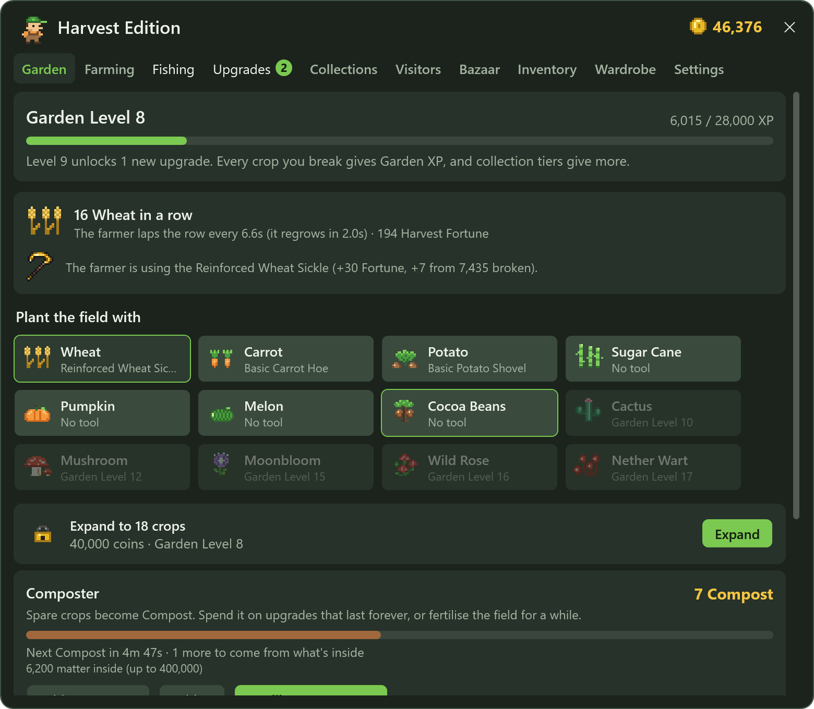
  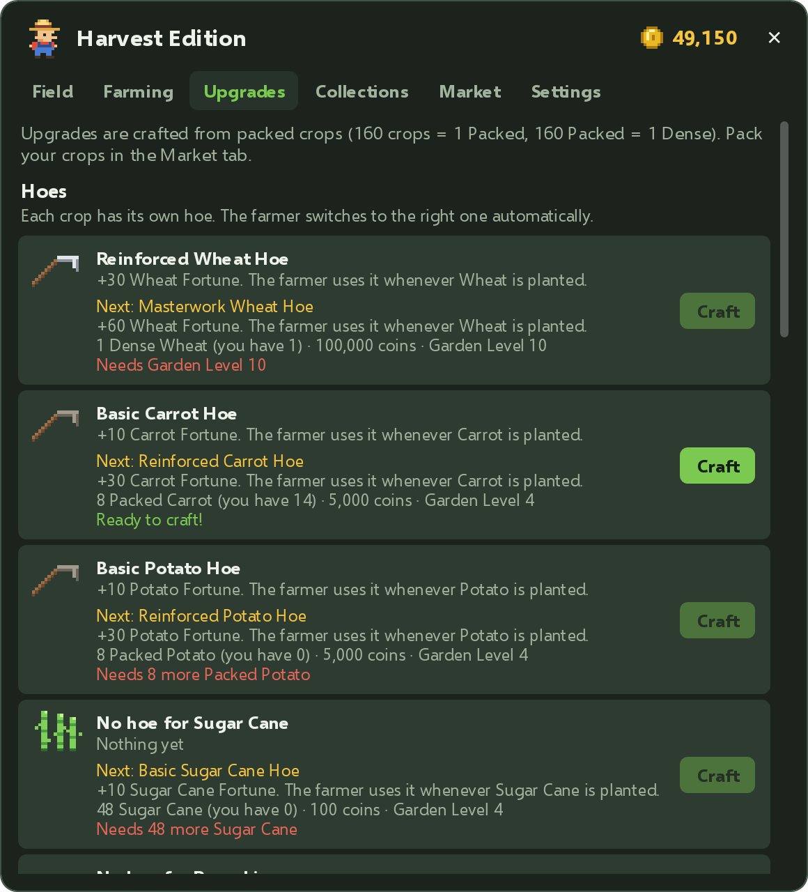
  
</p>

## Running it

Once a Harvest Edition release is out, download `TaskBarGame-HarvestEdition.exe` from the
[Releases](https://github.com/TheUthaGuy/TaskBarGame/releases) page (look for a `harvest-v` tag). It
updates itself from then on.

Until then, build the `.exe` yourself, or download the one GitHub builds for this branch: open
[Actions → Build](https://github.com/TheUthaGuy/TaskBarGame/actions/workflows/build.yml?query=branch%3Aharvest-edition),
click the newest run, and download **TaskBarGame-win-x64** under **Artifacts** (you need to be signed
in to GitHub). The [Download](#download) links at the bottom give the original edition, not this one.

To run it from the source code, you need **Windows 10 or 11** and the free
[.NET 10 SDK](https://dotnet.microsoft.com/download/dotnet/10.0).

```bash
dotnet run --project src/TaskBarGame.App
```

Or open `TaskBarGame.sln` in Visual Studio 2022/2026 and press **F5**.

To make a standalone `TaskBarGame.exe` you can share:

```bash
dotnet publish src/TaskBarGame.App -c Release -r win-x64 --self-contained true -p:PublishSingleFile=true -o publish
```

## How to play

| Do this | What happens |
|---|---|
| Click a **grown** crop | Break it yourself: +25 Harvest Fortune, and you see the XP you earned |
| Click a **growing** crop | Tend it: it regrows faster |
| **Hold the button and drag** along the row | Break (or tend) every crop you pass over |
| Right-click the row | Choose which crop to plant (the whole row changes) |
| Click the **farmer's head** or the **coins** | Open the panel |
| Right-click the farmer or the strip | Quick menu: plant, sell crops, strip size, position, show-on-hover, quit |
| Click the **lock** at the end of the row | Make the row longer (when you have the coins and Garden level) |
| Click the **visitor** after the row | See what visitors want (from Garden Level 2) |
| **Ctrl+Alt+F**, from any app | Open or close the panel |
| **Ctrl+Alt+H**, from any app | Hide or show the strip (both shortcuts can be changed in Settings) |

The farmer farms the row the way you would by hand: walking it from left to right breaking every grown
crop, then stepping on the teleport pad at the end, which sends them back to the pad at the start for the
next lap. They keep working while the game is closed, at half speed, for up to 12 hours. When you come
back, a popup tells you what they did.

### Stats

- **Harvest Fortune:** every 100 Fortune is one extra set of drops per crop broken (150 = 2.5x drops).
  It comes from your Farming level, that crop's collection, its tool (and the tool's counter), armour and
  the Clover talisman.
- **Farming Speed:** how fast the farmer walks the row, so how many crops they break a minute
  (Swiftstep talisman, Straw and Harvester set bonuses).
- **Farming XP:** bonus Farming XP from every crop (Scholar's talisman, Verdant set bonus).
- **Market sell price:** more coins when selling to the Market (Merchant's talisman). It doesn't apply
  to the Bazaar, or you could buy there and sell to the Market for free coins.

### Progression

- **Farming skill (levels 0-50):** XP from every crop broken. Each level gives **+4 Harvest Fortune** and coins.
- **Garden level (1-17):** Garden XP from every crop broken and every collection tier. Garden levels
  unlock crops, upgrades and field expansions.
- **Field:** starts at 10 crops and expands up to 24.
- **Collections:** 10 tiers per crop, each giving +2 Fortune for that crop and Garden XP. The
  Collections tab shows each crop's max (how many Tier X needs, from 2,000,000 Wheat to 10,000,000
  Melon) and how far you are towards it. Hover over a crop to see every tier.
- **Packing:** 160 crops pack into 1 **Packed** crop, and 160 Packed into 1 **Dense** crop. Packed crops
  sell for the same as the crops inside, but you need them for crafting.

Each crop is worth more per crop broken than the one before. The price of one item isn't the whole
story: a wheat drops 1 item, a carrot 3, a potato 4, so carrots and potatoes sell for less each but are
worth more per crop broken.

| Crop | Garden level | Regrows in | Drops | Sells for (each) | Worth per crop broken |
|---|---|---|---|---|---|
| Wheat | 1 | 2s | 1 | 2 | 2 |
| Carrot | 2 | 2.5s | 3 | 1 | 3 |
| Potato | 3 | 2.5s | 4 | 1 | 4 |
| Sugar Cane | 4 | 3s | 2 | 3 | 6 |
| Pumpkin | 5 | 3s | 1 | 9 | 9 |
| Melon | 6 | 3.5s | 5 | 2 | 10 |
| Cocoa Beans | 8 | 3.5s | 3 | 5 | 15 |
| Cactus | 10 | 4s | 2 | 9 | 18 |
| Mushroom | 12 | 4.5s | 1 | 24 | 24 |
| Moonbloom | 15 | 5s | 1 | 40 | 40 |
| Wild Rose | 16 | 5s | 2 | 24 | 48 |
| Nether Wart | 17 | 5.5s | 3 | 19 | 57 |

### Upgrades (crafted in the Upgrades tab)

**Tools:** every crop has its own tool, and the farmer automatically holds the one for the crop that's
planted, swinging it down onto each crop.

| Crop | Tool | Crop | Tool |
|---|---|---|---|
| Wheat | Wheat Sickle | Melon | Melon Dicer |
| Carrot | Carrot Hoe | Cocoa Beans | Cocoa Chopper |
| Potato | Potato Shovel | Cactus | Cactus Knife |
| Sugar Cane | Cane Cutter | Mushroom | Fungi Cutter |
| Pumpkin | Pumpkin Dicer | Moonbloom | Eclipse Sickle |
| Wild Rose | Rose Cutter | Nether Wart | Wart Cutter |

| Tier | Blade | Fortune for its crop | Made from |
|---|---|---|---|
| Basic | Iron | +10 | 48 of the crop + 100 coins |
| Reinforced | Gold | +30 | 8 Packed of the crop + 5,000 coins (Garden 4) |
| Masterwork | Blue | +60 | 1 Dense of the crop + 100,000 coins (Garden 10) |

Every 1,000 crops a tool breaks adds +1 Fortune for that crop (up to +30).

**Armour:** four pieces, each upgraded Straw → Harvester → Verdant. Wearing a full set gives a bonus.

| Set | Fortune per piece | Full set bonus | Made from |
|---|---|---|---|
| Straw | +4 | +5% Farming Speed | Packed Wheat (Garden 2) |
| Harvester | +10 | +15 Fortune, +5% Farming Speed | Packed Pumpkin, Melon, Sugar Cane, Potato (Garden 6) |
| Verdant | +20 | +25 Fortune, +10% Farming XP | Dense Cocoa, Cactus, Mushroom, Moonbloom (Garden 12-15) |

**Talismans:** four kinds, each upgraded Charm → Ring → Relic (+5 / +10 / +20). Owning one is enough.

| Talisman | Gives | Made from |
|---|---|---|
| Clover | Harvest Fortune | Carrot |
| Swiftstep | Farming Speed % | Sugar Cane |
| Merchant's | Market sell price % | Potato, then Melon |
| Scholar's | Farming XP % | Wheat, then Pumpkin, then Cocoa |

**Compactor:** packs crops for you as they're harvested, so you don't have to press Pack.

| Tier | What it does | Made from |
|---|---|---|
| Compactor | Every 160 crops become 1 Packed crop | 8 Packed Wheat + 8 Packed Carrot + 5,000 coins (Garden 3) |
| Dense Compactor | Also presses every 160 Packed into 1 Dense crop | 1 Dense Wheat + 16 Packed Melon + 100,000 coins (Garden 9) |

You can turn it off for any crop in the Inventory tab. It leaves alone any plain crops your next upgrades
use as they are (like the 48 crops for a first tool).

The number on the **Upgrades** tab is how many upgrades you can craft right now, and a popup tells you
when a new one becomes ready. If an upgrade is only missing ingredients, **Buy missing** buys them on
the Bazaar in one click and shows what that costs.

### Rare finds

Every crop broken (by the farmer or by you, even while the game is closed) has a tiny chance of turning
up something rare, with a pop-up and a burst of gold sparkles. The first of each kind goes in the
**Rare Finds** album (Collections tab) and gives a bonus for good; more of them sell for lots of coins.

| Rare find | Chance per crop | First find gives | Sells for |
|---|---|---|---|
| Four-Leaf Clover | 1 in 5,000 | +5 Harvest Fortune | 2,000 |
| Golden Seed | 1 in 20,000 | +3% Farming Speed | 10,000 |
| Ancient Coin | 1 in 40,000 | +5% Market sell price | 25,000 |
| Lucky Horseshoe | 1 in 60,000 | +5% Farming XP | 40,000 |
| Star Fragment | 1 in 150,000 | +10 Harvest Fortune | 100,000 |
| Crystal Acorn | 1 in 400,000 | +5% Farming Speed and +5% Farming XP | 250,000 |

### Visitors

From **Garden Level 2**, visitors come to the garden: a new one every 15 minutes (also while the game is
closed), up to 3 at a time. They stand just after your row with a "!" above them. Each one asks for
crops (packed crops at higher Garden levels) and pays about 1.5 times what the Market would, plus Farming
XP, Garden XP and **Garden Tokens**. Rarer visitors (Uncommon, Rare, Legendary) ask for more and pay more.
In the **Visitors** tab you can accept, buy what's missing on the Bazaar, or send them away.

The **Visitor Shop** sells, for tokens:

| Item | What it does | Tokens |
|---|---|---|
| Lucky Seeds | +40 Harvest Fortune for 30 minutes | 6 |
| Swift Tonic | +15% Farming Speed for 30 minutes | 6 |
| Scholar's Tea | +25% Farming XP for 30 minutes | 5 |
| Bag of Compost | 5 Compost | 8 |
| Garden Bench | Room for one more visitor (up to 6) | 15, 30, 60 |
| Traveller's Hood, Wanderer's Garb, Stargazer's Hat | Wardrobe hats and an outfit | 20, 35, 50 |

Buying a boost again adds 30 minutes (up to 3 hours). Boosts count down while the game is closed.

### Composter

From **Garden Level 3**, the Composter (in the **Garden** tab) turns spare crops into Compost. Each crop
you put in adds its Market value as matter; every 10 minutes, 4,000 matter becomes 1 Compost (it keeps
working while the game is closed). **Add spare crops** puts in what you could sell to the Market (not
locked, not kept for upgrades). Compost buys:

| Upgrade (lasts forever) | Per level | Levels | Compost for level N |
|---|---|---|---|
| Rich Soil | +4 Harvest Fortune for every crop | 10 | 3 × N |
| Quick Steps | +2% Farming Speed | 5 | 5 × N |
| Wise Roots | +2% Farming XP | 5 | 4 × N |
| Busy Composter | The Composter works 10% faster | 5 | 4 × N |

or **fertiliser**: 3 Compost for +30 Harvest Fortune for 20 minutes.

<p>
  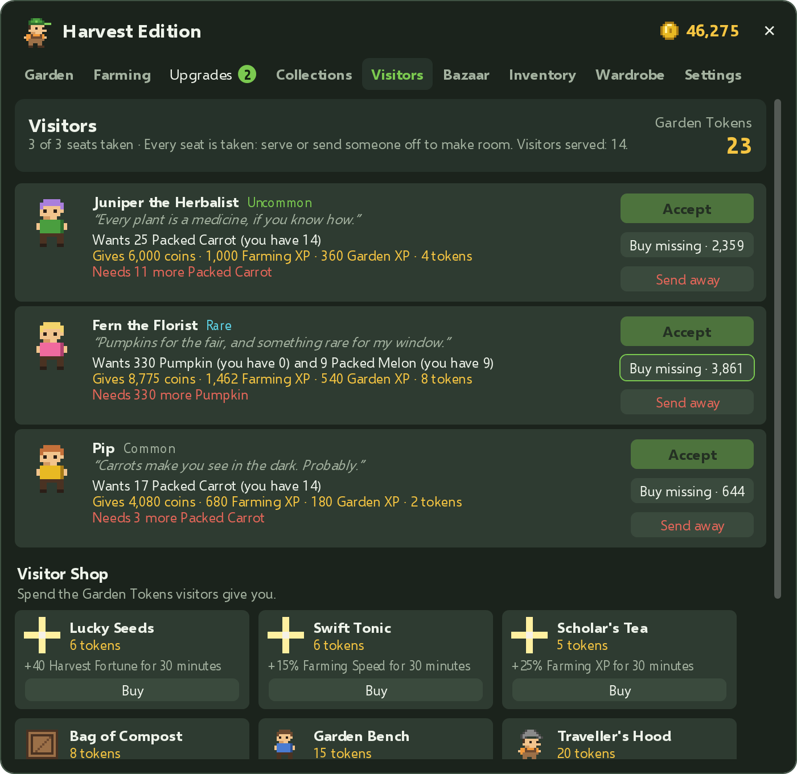
  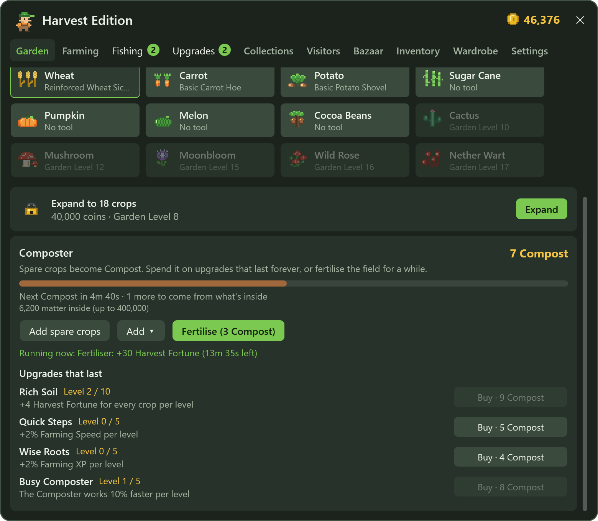
</p>

### Fishing

Click the rod button next to your coins on the strip (or use the **Fishing** tab) to send the farmer
fishing. The row turns into a lake and the farmer stands on a wooden pontoon. They cast, the bobber
floats until a "!" shows something biting, and they reel it in, all by themselves, even while the game
is closed (at half speed, like farming). Your crops keep growing while they're away, so the field is full
when they come back. Click the button again (it shows your crop) to go back to the field.

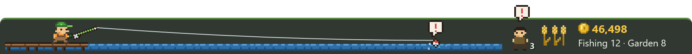

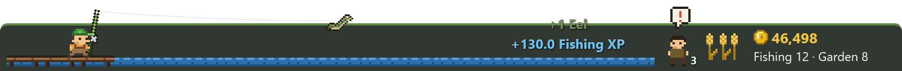

| Lake | How to get there | What bites |
|---|---|---|
| **Willow Lake** | On your island: always open | Perch, Carp, Trout (Fishing 3), Pike (6), Eel (10), Catfish (15), Golden Carp (20, rare), and Lily Pads, Clay, Ink Sacs (5) and Sponges (12) |
| **Driftwood Cove** | A boat trip for 50,000 coins (once) | Mackerel, Sea Bass (8), Snapper (14), Swordfish (22, rare), Ink Sacs, Sponges, and **junk**: Tin Cans, Soggy Boots, Tangled Nets, Broken Bottles and the odd Rusty Anchor |

Every catch gives **Fishing XP**. Each Fishing level (up to 50) gives +1 Fishing Speed and coins, and
some unlock new fish. Your stats:

- **Fishing Speed**: fish bite every 20 seconds ÷ (1 + Fishing Speed ÷ 100), on average.
- **Treasure Chance** (3% to start): the chance a catch is **treasure** instead: Waxed Canvas, Brass
  Hooks and Spools of Line, or a rarer "Great catch!" River Pearl or Tide Gem. Treasure is what rods and
  fishing armour are made from.
- **Double Catch**: the chance a catch comes up two at a time.

**Rods** (crafted in the Fishing tab from fish and treasure; everyone starts with a Fishing Rod):

| Rod | Rarity | Fishing level | Fishing Speed | Treasure Chance |
|---|---|---|---|---|
| Fishing Rod | Common | – | +5 | – |
| Angler's Rod | Uncommon | 10 | +35 | +0.5% |
| Lakewarden Rod | Rare | 15 | +50 | +1% |
| Stormcatcher Rod | Epic | 20 | +65 | +1.5% |
| Tidecaller Rod | Legendary | 24 | +80 | +2.5% |

**Fishing armour** is worn while fishing (your farming armour is worn at the field): **Oilskin** (Fishing
5), **Mariner** (12) and **Deepwater** (22), with Fishing Speed and Treasure Chance on every piece and a
set bonus for all four.

**Bait** is used up one per catch while it's chosen (when it runs out, the farmer fishes without it):

| Bait | Does | Bait table recipe |
|---|---|---|
| Wriggler Bait | +30 Fishing Speed | 1 Perch + 1 Lily Pad → 25 |
| Glimmer Bait | +3% Treasure Chance | 2 Carp + 1 Ink Sac → 25 (Fishing 5) |
| Twin Bait | +20% Double Catch | 2 Pike + 2 Clay → 25 (Fishing 8) |

**Rusty Rowan** runs a junk shop at Driftwood Cove (he stands on the jetty at the end of the cove). Once
you've bought the boat trip, he trades the junk you fish up there for bait, treasure (canvas, hooks, line,
pearls and Tide Gems), a Bucket Hat and the Beachcomber Blue outfit. Reaching Fishing 10 also unlocks the
Sou'wester hat.

The Fishing tab also shows **what's biting** (each catch's chance at your level and its price), your
catches per hour, and the **catch log** of everything you've reeled in.

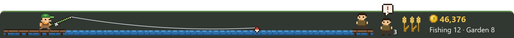

<p>
  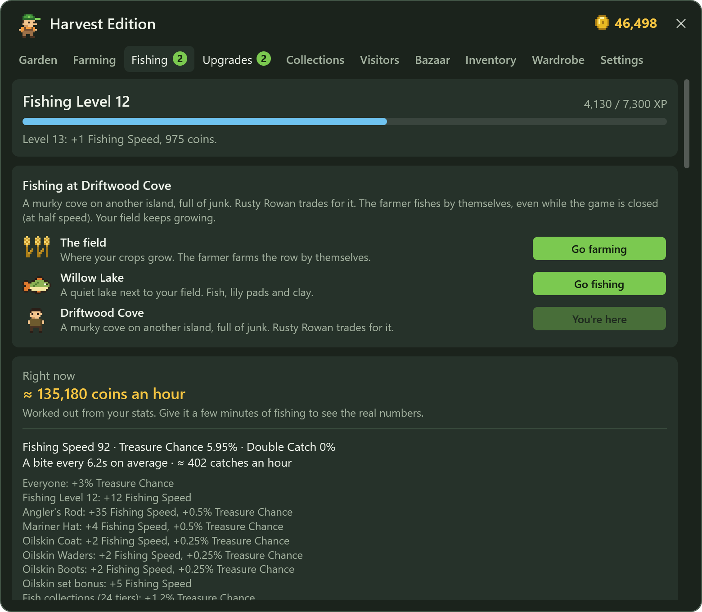
  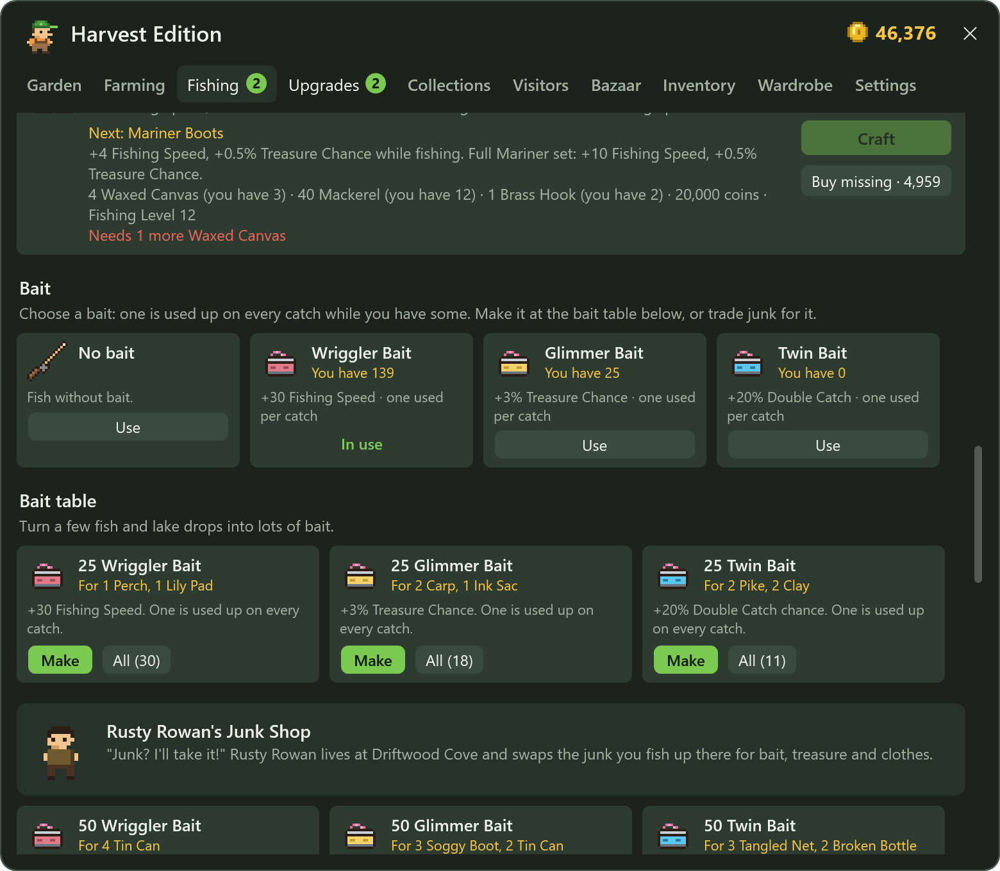
</p>

### Bazaar

Buy and sell crops, packed crops and dense crops with other (pretend) farmers in the **Bazaar** tab.

- Every item has a **sell price** (what you get now) and a slightly higher **buy price** (what it costs
  now). Prices drift a little every minute and slowly return to normal. Selling a lot at once pushes the
  price down; buying a lot pushes it up. The arrows show how much it moved in the last hour.
- **Sell now / Buy now** trade straight away.
- **Sell offer** asks for a bit more than the sell price: your items are set aside and the coins arrive
  bit by bit while buyers are paying that much. **Buy order** bids a bit under the buy price: your coins
  are set aside and the items arrive while sellers are that cheap. Orders keep filling while the game is
  closed, and you can cancel them to get back whatever hasn't filled.
- Type **your own price** for a sell offer or buy order, or leave the box empty for the automatic one
  (just better than the current price, so it fills soon). You're warned if your price is worse than
  trading straight away.
- The **chart** shows the item's sell price over the last 2 hours, so you can tell a good time to sell.
- The **search box** finds items by name: "melon" shows Melon, Packed Melon and Dense Melon.
- On average the Bazaar pays about 20% more than the Market. Buying packed and dense crops here is a
  quick way to get materials for upgrades.

### Inventory

The **Inventory** tab is for packing crops and selling quickly to the Market.

- **Pack ▾** lets you choose how many to pack (1, 5, 10... or all). **Pack everything** packs it all.
- **Lock** an item and it's never sold: not by a Sell button, auto-sell or the Bazaar.
- **Keep enough crops for my next upgrades** (on by default): selling to the Market, Sell all crops and
  auto-sell keep back what your next tools, armour, talismans and Compactor need, counting the crops you
  still have to pack. Each item shows how many it's keeping.
- **Auto-sell** is chosen crop by crop: those crops are sold to the Market as soon as they're harvested
  (apart from what's kept for upgrades). The same list turns the Compactor on or off for each crop.

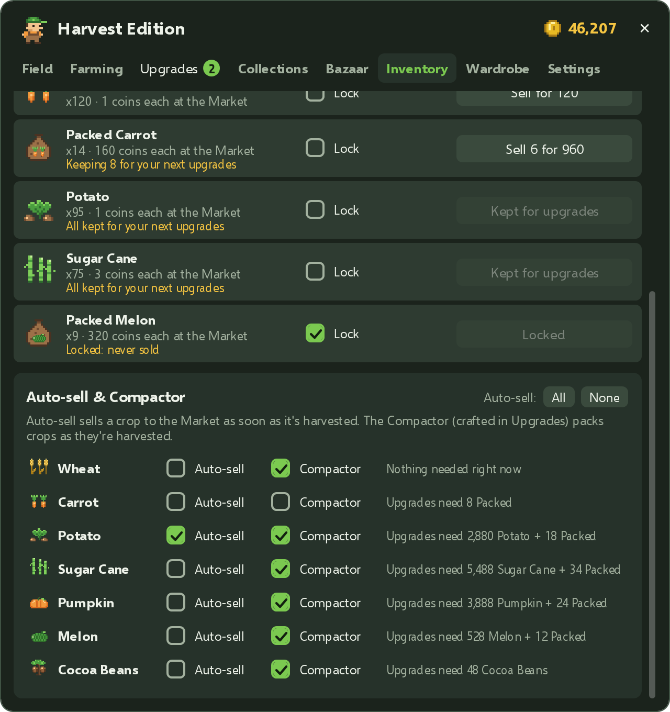

The **Farming** tab's crop guide shows roughly how many coins an hour each crop would make you, with
your tools, Fortune and speed, and marks the best one. Its **Right now** card measures how fast your farm
is actually going (coins, crops and Farming XP an hour, over the last 10 minutes and since the game
started), so you can see whether an upgrade made a difference.

### Wardrobe

Milestones unlock hats and outfits for your farmer. They're just for looks: pick one in the
**Wardrobe** tab and the farmer wears it on the strip.

| Hat | Unlocked by | Outfit | Unlocked by |
|---|---|---|---|
| Straw Hat | Every farmer starts with one | Classic Overalls | Every farmer starts with these |
| Farmer's Cap | Farming Level 10 | Harvest Brown | Garden Level 5 |
| Bandana | Breaking 10,000 crops | Meadow Green | Breaking 1,000 crops by hand |
| Top Hat | Earning 1,000,000 coins from selling | Twilight Purple | Garden Level 10 |
| Flower Crown | Maxing out any collection | Golden Harvest | Wearing a full Verdant armour set |
| Golden Crown | Farming Level 50 | | |

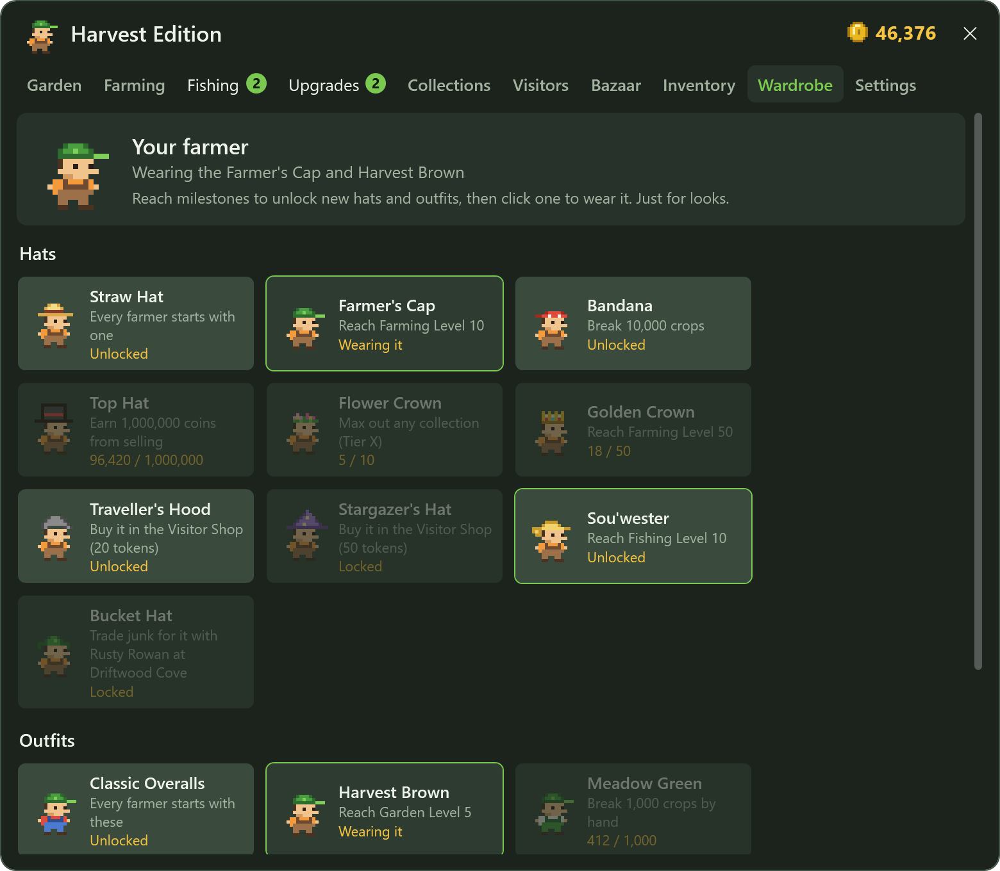

<p>
  
  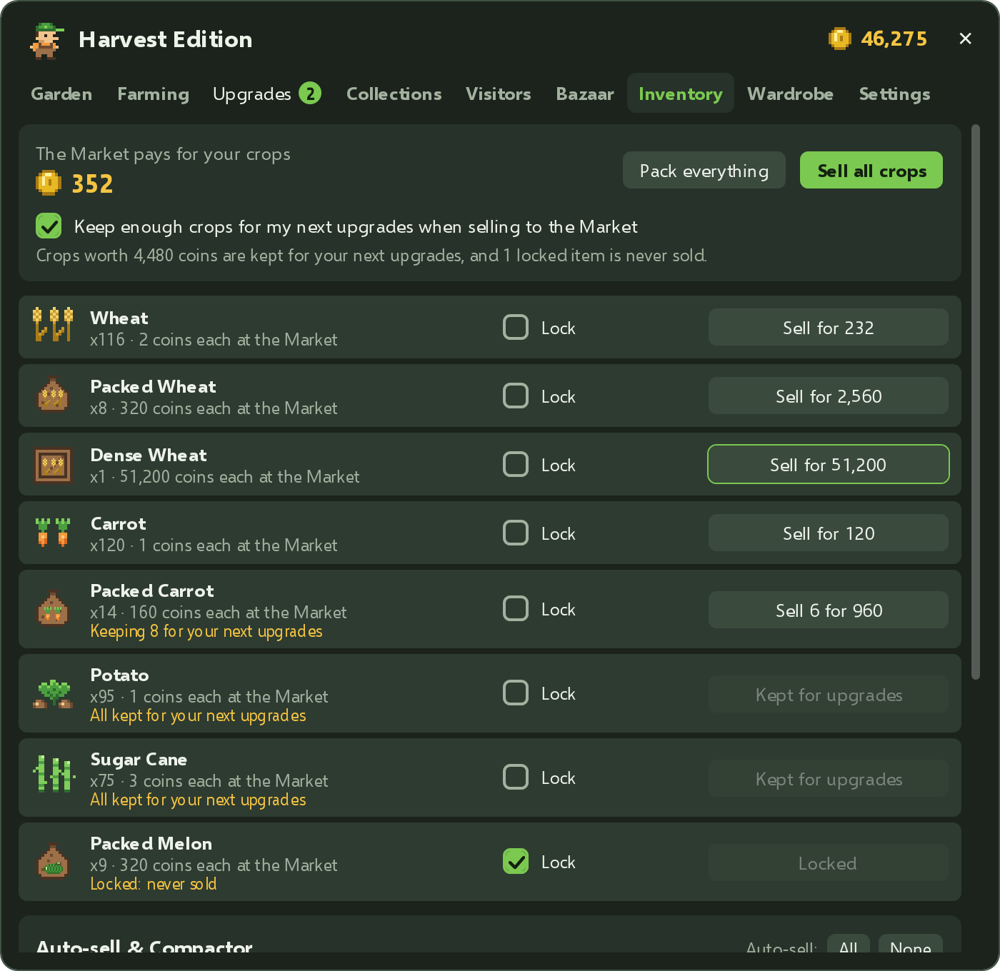
  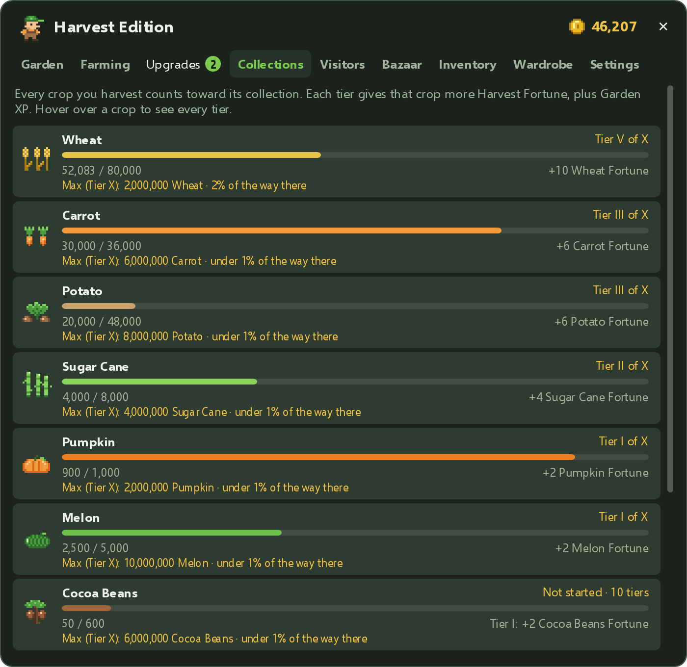
</p>

### Settings

In the panel's **Settings** tab (or the right-click menu):

- **Only show it when I hover:** the strip tucks away and only the farmer stays visible. Hover over the
  farmer to show the field. The farmer keeps working either way.

  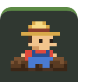

- **Size:** Small / Normal / Large.
- **Position:** Left / Center / Right of the screen.
- **Monitor:** which monitor the strip sits on (it sits above that monitor's taskbar, or at the bottom
  of the screen if it has none). If that monitor is unplugged, the strip goes back to the main one.
- **Keyboard shortcuts:** click one and press the keys you want (with Ctrl, Alt or Win), or choose None.
- **Pop-ups:** choose which ones you see (level-ups, collection tiers, upgrades ready, crafted upgrades,
  Bazaar orders, welcome back), or pause them all for a while.
- **Short numbers:** 12.3K and 1.23M instead of 12,345 and 1,234,567.
- **Battery saver** (on by default): the strip animates less often while the laptop is on battery. The
  farmer and your crops keep the same pace. While a fullscreen app hides the strip, the game always
  updates less often.
- **Updates:** check for new versions, and install them without asking if you like (see [Updates](#updates)).
- Farmer auto-farming, keeping crops for upgrades, floating numbers, hide during fullscreen apps, start
  with Windows.

The panel opens where you last dragged it, on the tab you last had open.

### Updates

A little after it starts, and then every 6 hours, the game looks on GitHub for a newer Harvest Edition
release. When there is one, a pop-up asks if you want it, and the strip says so under your coins.

- **Update now** (in the pop-up, or **Settings → Updates**) downloads the new version, checks that it's
  exactly the file GitHub published (its SHA-256 checksum), saves your farm and restarts the game. If the
  check fails, nothing is installed.
- Turn on **Install new versions without asking** to have updates installed in the background. They
  start the next time the game opens (or straight away with **Restart now**).
- **Check now** looks for a new version straight away; **What's new** opens the release page.
- This works for the single `TaskBarGame-HarvestEdition.exe` from a release. A copy built from the source
  code as a folder of files tells you about new versions but has to be updated by hand.

Your save file is `%APPDATA%\TaskBarGame Harvest Edition\save.json` (with a `.bak` backup).
The game also keeps the last 10 **backups** in the `backups` folder next to it: one each time it starts
and one every 2 hours. In **Settings → Save file** you can restore one, make one now, **export** your
farm to a file and **import** one. Restoring or importing backs up your current farm first, then restarts
the game to load the other one. If something
breaks, details are written to `%APPDATA%\TaskBarGame Harvest Edition\error.log`.

## Changing the game

| I want to change... | Edit |
|---|---|
| Crop regrow time, drops, price, XP, unlock level | `src/TaskBarGame.Core/Crops.cs` |
| Tool, armour and talisman stats, and every crafting recipe | `src/TaskBarGame.Core/Equipment.cs` |
| Packed and Dense crops | `src/TaskBarGame.Core/Items.cs` |
| Level XP tables, field expansions, collection tiers | `src/TaskBarGame.Core/Progression.cs` |
| Breaking, fortune, crafting and offline rules | `src/TaskBarGame.Core/GameEngine.cs` |
| Bazaar prices, trades and orders | `src/TaskBarGame.Core/Bazaar.cs` |
| How the farmer walks the row and teleports | `src/TaskBarGame.Core/FarmerAgent.cs` |
| **Fishing**: fish, lakes, what bites, treasure, rods, fishing armour, bait, Rusty Rowan's trades | `src/TaskBarGame.Core/Fishing.cs` |
| Fishing rules (catching, stats, boat trips, trades) and how the farmer casts and reels in | `src/TaskBarGame.Core/FishingEngine.cs`, `AnglerAgent.cs` |
| **Pixel art** (crops, farmer, hats, visitors, rare finds, fish, the lake, rods, fishing armour, icons) | `src/TaskBarGame.Core/Assets/sprites.txt`, a plain text file with one letter per pixel |
| **Tool, armour and talisman pictures** (16x16 PNGs) | `src/TaskBarGame.App/Assets/Tools`, `Assets/Armour` and `Assets/Talismans` (which file each one uses: `Equipment.cs`) |
| Tools' blade colours per tier, outfit colours, fish, rod and fishing armour colours | `src/TaskBarGame.App/SpriteCache.cs` |
| The strip above the taskbar | `src/TaskBarGame.App/StripWindow.xaml.cs` |
| The panel | `src/TaskBarGame.App/PanelWindow.xaml` + `ViewModels/` |
| Colours and button styles | `src/TaskBarGame.App/Theme.xaml` |
| The screenshots in this README | see [Screenshots](#screenshots) below |

Run the tests after changing game rules:

```bash
dotnet test
```

### Screenshots

The game has a screenshot mode that plays a demo field (it never touches your save), saves pictures
of the strip and every panel tab (and the bottom of the longer ones), then quits:

```bash
TaskBarGame.exe --screenshots docs\screenshots
```

To take them on a real Windows machine without installing anything, open **Actions → Build → Run
workflow** on GitHub: when it's done, the run has a **screenshots** download. The screenshots in
`docs/screenshots` were taken that way.

You can also take them on Linux by running the real Windows build under Wine with
`tools/linux-screenshots.sh`. The game draws everything itself, so they match Windows except for the
font: Wine has no Segoe UI, so the script uses Selawik, Microsoft's open-source stand-in for it.

### Making a release

Harvest Edition releases are tagged `harvest-v<version>` (for example `harvest-v0.2.0`), so they never
mix with the original edition's `v0.1.0` releases. They're also never marked as the repo's "latest"
release, so the original edition's download links on `main` keep working.

1. Set the new version in `src/TaskBarGame.App/TaskBarGame.App.csproj` (`<Version>`).
2. Write the release notes in `docs/releases/harvest-v<version>.md` (copy the previous one).
3. On GitHub, open **Actions → Release (Harvest Edition) → Run workflow**, pick the branch to release
   (for example `harvest-edition`), type the version (for example `0.2.0`) and click **Run workflow**.

About two minutes later the release has three files: `TaskBarGame-HarvestEdition.exe`, a zipped copy,
and `TaskBarGame-HarvestEdition.exe.sha256` (the checksum the game checks updates against). Copies of
the game that are already installed find it by themselves (see [Updates](#updates)). Pushing a
`harvest-v0.2.0` tag also works.

To try updating without publishing anything, set the `TBG_UPDATE_FEED` environment variable to the
address of a file shaped like GitHub's
[list of releases](https://docs.github.com/en/rest/releases/releases#list-releases): the game then
checks that instead of GitHub.

### Project layout

```
src/TaskBarGame.Core/     Game rules, saving and sprite loading. No Windows code, fully unit tested.
src/TaskBarGame.App/      The Windows (WPF) app: the taskbar strip, the panel, Windows integration.
tests/                    xUnit tests for TaskBarGame.Core.
tools/                    linux-screenshots.sh, which remakes the README screenshots on Linux.
docs/screenshots/         The pictures in this README.
```

## Coming next

- **Sea creatures** to fish up and fight, and the Leviathan Rod.
- **More islands**, fishing pets and fishing accessories.
- **Auction house:** buy and sell tools, armour and talismans.
- **Pests**, **farming contests** and more for the garden.
- **More skills:** combat, mining, foraging and more.

## Download

These links give the **original edition** (the `main` branch), not the Harvest Edition. For the
Harvest Edition, see [Running it](#running-it).

**Latest version: v0.1.0** (Farming and the Garden)

| Download | |
|---|---|
| [**TaskBarGame.exe**](https://github.com/TheUthaGuy/TaskBarGame/releases/latest/download/TaskBarGame.exe) | Windows 10/11, 64-bit. Just run it, nothing to install (about 65 MB). |
| [TaskBarGame-win-x64.zip](https://github.com/TheUthaGuy/TaskBarGame/releases/latest/download/TaskBarGame-win-x64.zip) | The same game, zipped, if your browser blocks `.exe` downloads. |

Every version and its release notes are on the [Releases](https://github.com/TheUthaGuy/TaskBarGame/releases) page.

Windows may say "Windows protected your PC" because the game isn't signed yet. Click
**More info → Run anyway**.
