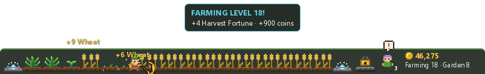

# TaskBarGame

A little farming game that lives just above your Windows taskbar while you work.

A farmer works a strip of crop plots: they sweep back and forth along the row with their hoe,
breaking every ripe crop they pass, just like farming a row by hand. You earn coins, level up
your **Farming** skill and your **Garden**, unlock new crops and buy more plots. You can also click
crops yourself to farm faster.



Click the farmer (or your coins) to open the garden panel:

<p>
  
  
  
</p>

## Running it

The easiest way is to grab `TaskBarGame.exe` from [Download](#download) at the bottom of this page
and run it. Nothing to install.

To run it from the source code instead, you need **Windows 10 or 11** and the free
[.NET 10 SDK](https://dotnet.microsoft.com/download/dotnet/10.0).

```bash
dotnet run --project src/TaskBarGame.App
```

Or open `TaskBarGame.sln` in Visual Studio 2022/2026 and press **F5**.

To make a standalone `TaskBarGame.exe` you can share:

```bash
dotnet publish src/TaskBarGame.App -c Release -r win-x64 --self-contained true -p:PublishSingleFile=true -o publish
```

GitHub Actions also builds the `.exe` on every push. Download it from the **Actions** tab under **Artifacts**.

## How to play

| Do this | What happens |
|---|---|
| Click a **ripe** crop (it sparkles) | Harvest it yourself: +25 Harvest Fortune and you see the XP you earned |
| Click a **growing** crop | Tend it: it grows 4% faster per click |
| Right-click a plot | Choose what to plant there |
| Click the **farmer's head** or the **coins** | Open the garden panel |
| Right-click the farmer or the strip | Quick menu: sell crops, strip size, position, show-on-hover, quit |
| Click the **lock** | Buy the next plot (when you have the coins and Garden level) |

Whenever something is ripe, the farmer sweeps side to side along the row, swinging their hoe and
breaking each ripe crop they walk over (bits of crop fly out), then turns around at the end of the row.
When nothing is ripe they take a break. They keep farming even while the game is closed: at half speed,
for up to 12 hours. When you come back, a popup tells you what they did.

### Progression

- **Farming skill (levels 0-50):** XP from every harvest. Each level gives **+4 Harvest Fortune** and coins.
- **Harvest Fortune:** every 100 Fortune is one extra set of crops per harvest (150 = 2.5x crops).
- **Garden level (1-15):** Garden XP from every harvest and every collection tier. Garden levels unlock
  new crops and let you buy more plots (up to 12).
- **Collections:** every crop item you harvest counts. Each of the 10 tiers per crop gives +2 Fortune for
  that crop and Garden XP.
- **Market:** sell crops for coins, or turn on auto-sell.

| Crop | Garden level | Grows in | Sells for |
|---|---|---|---|
| Wheat | 1 | 30s | 2 |
| Carrot | 2 | 40s | 2 |
| Potato | 3 | 50s | 3 |
| Sugar Cane | 4 | 1m | 5 |
| Pumpkin | 5 | 1m 30s | 18 |
| Melon | 6 | 1m 40s | 5 |
| Cocoa Beans | 8 | 2m | 15 |
| Cactus | 10 | 2m 30s | 16 |
| Mushroom | 12 | 3m | 35 |
| Moonbloom | 15 | 8m | 160 |

### Settings

In the panel's **Settings** tab (or the right-click menu):

- **Only show it when I hover:** the strip tucks away and only the farmer stays visible, with a badge
  showing how many crops are ready. Hover over the farmer to show the strip.

  

- **Size:** Small / Normal / Large.
- **Position:** Left / Center / Right of the screen.
- Farmer auto-harvest, auto-sell, floating numbers, hide during fullscreen apps, start with Windows.

Your save file is `%APPDATA%\TaskBarGame\save.json` (with a `.bak` backup). If something breaks,
details are written to `%APPDATA%\TaskBarGame\error.log`.

## Changing the game

| I want to change... | Edit |
|---|---|
| Crop speed, price, XP, unlock level | `src/TaskBarGame.Core/Crops.cs` |
| Level XP tables, plot prices, collection tiers | `src/TaskBarGame.Core/Progression.cs` |
| Harvest/tend/offline rules | `src/TaskBarGame.Core/GameEngine.cs` |
| How the farmer sweeps the row | `src/TaskBarGame.Core/FarmerAgent.cs` |
| **Pixel art** (crops, farmer, icons) | `src/TaskBarGame.Core/Assets/sprites.txt`, a plain text file with one letter per pixel |
| The strip above the taskbar | `src/TaskBarGame.App/StripWindow.xaml.cs` |
| The garden panel | `src/TaskBarGame.App/PanelWindow.xaml` + `ViewModels/` |
| Colours and button styles | `src/TaskBarGame.App/Theme.xaml` |
| The screenshots in this README | see [Screenshots](#screenshots) below |

Run the tests after changing game rules:

```bash
dotnet test
```

### Screenshots

The game has a screenshot mode that plays a demo garden (it never touches your save), saves pictures
of the strip and every panel tab, then quits:

```bash
TaskBarGame.exe --screenshots docs\screenshots
```

The screenshots in `docs/screenshots` were taken on Linux by running the real Windows build under
Wine with `tools/linux-screenshots.sh`. The game draws everything itself, so they match Windows
except for the font: Wine has no Segoe UI, so the script uses Selawik, Microsoft's open-source
stand-in for it.

### Making a release

1. Set the new version in `src/TaskBarGame.App/TaskBarGame.App.csproj` (`<Version>`) and in the
   [Download](#download) section below.
2. Write the release notes in `docs/releases/v<version>.md` (copy the previous one).
3. On GitHub, open **Actions → Release → Run workflow**, type the version (for example `0.2.0`) and
   click **Run workflow**.

About two minutes later `TaskBarGame.exe` is on the
[Releases](https://github.com/TheUthaGuy/TaskBarGame/releases) page. The download links below always
point at the newest release, so they never need changing. (Publishing a release from the Releases
page, or pushing a `v0.2.0` tag, also works: the workflow adds the game files either way.)

### Project layout

```
src/TaskBarGame.Core/     Game rules, saving and sprite loading. No Windows code, fully unit tested.
src/TaskBarGame.App/      The Windows (WPF) app: the taskbar strip, the panel, Windows integration.
tests/                    xUnit tests for TaskBarGame.Core.
tools/                    linux-screenshots.sh, which remakes the README screenshots on Linux.
docs/screenshots/         The pictures in this README.
```

## Coming next

- **Visitors:** characters who stop by the garden and ask for crops in exchange for rewards.
- **Composter and upgrades:** turn spare crops into compost, buy better tools and crop upgrades.

## Download

**Latest version: v0.1.0** (Farming and the Garden)

| Download | |
|---|---|
| [**TaskBarGame.exe**](https://github.com/TheUthaGuy/TaskBarGame/releases/latest/download/TaskBarGame.exe) | Windows 10/11, 64-bit. Just run it, nothing to install (about 65 MB). |
| [TaskBarGame-win-x64.zip](https://github.com/TheUthaGuy/TaskBarGame/releases/latest/download/TaskBarGame-win-x64.zip) | The same game, zipped, if your browser blocks `.exe` downloads. |

Every version and its release notes are on the [Releases](https://github.com/TheUthaGuy/TaskBarGame/releases) page.

Windows may say "Windows protected your PC" because the game isn't signed yet. Click
**More info → Run anyway**.
